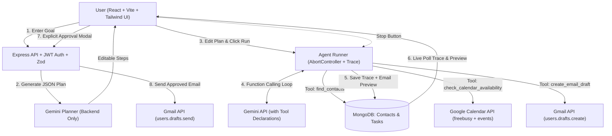

# MailPilot AI — Smart Email Agent

> **Hackathon Theme 2: Tool-Using & API Agents**
> A full-stack AI email workflow agent that turns plain-English goals into editable execution plans, selects real tools via Gemini function calling, inspects Google Calendar availability, searches a MongoDB contacts directory, creates Gmail drafts, shows a full live execution trace, and **never sends an email without explicit user approval**.

---

## Key Features

1. **Authentication & Security**: User registration and login with `bcryptjs` password hashing, JWT authentication, and Zod schema validation.
2. **Plain-English Goal Workspace**: Describe email goals naturally (e.g., *"Find Sarah from Design, check my calendar tomorrow afternoon, and draft an invite"*).
3. **AI-Generated Editable Task Plans**: Gemini generates a structured step-by-step plan that users can edit, reorder, add, or remove before execution.
4. **Gemini Function Calling**: Backend Gemini agent dynamically selects and invokes Zod-validated tools (`find_contacts`, `check_calendar_availability`, `create_email_draft`).
5. **Real Google Integrations**:
   - **Gmail API**: Creates real Gmail drafts (`users.drafts.create`) and sends approved emails (`users.drafts.send` / `users.messages.send`).
   - **Google Calendar API**: Checks real free/busy availability and events (`freebusy.query`, `events.list`).
6. **MongoDB Contacts Directory**: Searchable contacts database with CRUD UI and sample seed helper.
7. **Visible Execution Trace**: Real-time trace showing plan updates, agent reasoning, tool names, validated JSON inputs/outputs, retries, duration, and fallback events.
8. **Task Lifecycle & Stop Button**: Full support for `pending`, `running`, `completed`, and `failed` statuses, plus an immediate **Stop Agent** button backed by `AbortController`.
9. **Error Handling, Retries & Fallbacks**: Exponential backoff retries for transient API failures and graceful fallback handling when integrations are unavailable.
10. **Email Preview & Explicit User Approval**: Editable email preview paired with a native confirmation modal (`<dialog>`) requiring explicit user confirmation before Gmail sends anything.
11. **Task History**: Review, filter, inspect traces, or reopen previous tasks.

---

## Agent Architecture Diagram



---

## Tech Stack

- **Frontend**: React 19, Vite, React Router, Tailwind CSS v4, Axios, Lucide Icons
- **Backend**: Node.js, Express.js, JWT (`jsonwebtoken`), `bcryptjs`, Zod
- **AI**: `@google/genai` (Gemini API with Function Calling & JSON structured output)
- **External APIs**: `googleapis` (OAuth 2.0, Gmail API v1, Google Calendar API v3)
- **Database**: MongoDB with Mongoose

---

## Project Structure

```text
mail agent/
├── index.html
├── package.json                  # Frontend dependencies & root scripts
├── vite.config.js                # Vite + Tailwind v4 + /api proxy to :5000
├── src/
│   ├── api/client.js             # Axios instance with JWT interceptor
│   ├── context/AuthContext.jsx   # Session & integration state
│   ├── components/
│   │   ├── Navbar.jsx            # Navigation + Google OAuth connect/disconnect
│   │   ├── PlanEditor.jsx        # Editable steps, Run & Stop controls
│   │   ├── ExecutionTrace.jsx    # Live tool inputs, outputs, retries, fallbacks
│   │   ├── EmailPreviewCard.jsx  # Editable preview + native <dialog> approval modal
│   │   ├── ProtectedRoute.jsx
│   │   └── StatusBadge.jsx
│   └── pages/
│       ├── LoginPage.jsx
│       ├── RegisterPage.jsx
│       ├── DashboardPage.jsx
│       ├── HistoryPage.jsx
│       └── ContactsPage.jsx
└── server/
    ├── .env.example              # Backend environment template
    ├── package.json              # Backend dependencies & test script
    ├── index.js                  # DB connection & server startup
    ├── app.js                    # Express app & routes
    ├── config/
    │   ├── env.js                # Zod-validated backend environment variables
    │   └── db.js                 # MongoDB Mongoose connection
    ├── middleware/auth.js        # JWT Bearer token middleware
    ├── models/
    │   ├── User.js               # User + private Google OAuth tokens
    │   ├── Contact.js            # User contacts directory
    │   └── Task.js               # Goal, plan, trace, emailDraft, status
    ├── routes/
    │   ├── auth.js               # /api/auth/register, /login, /me
    │   ├── contacts.js           # /api/contacts CRUD & /seed
    │   ├── google.js             # /api/google/auth-url, /callback, /disconnect
    │   └── tasks.js              # /api/tasks/plan, /:id/run, /:id/stop, /approve-send
    ├── services/
    │   ├── geminiService.js      # Gemini planner & function-calling turns
    │   ├── googleService.js      # Real Gmail & Google Calendar API wrappers
    │   ├── toolRegistry.js       # Zod-validated tools & declarations
    │   └── agentRunner.js        # Multi-turn loop, AbortController, trace persistence
    ├── utils/retry.js            # Exponential backoff retry & AbortError
    └── tests/api.test.js         # Automated backend & agent integration tests
```

---

## Setup & Running Locally

### 1. Prerequisites
- Node.js 20+
- MongoDB (local `mongod` or a [MongoDB Atlas](https://www.mongodb.com/atlas) connection string)
- A Google Gemini API key from [Google AI Studio](https://aistudio.google.com/)
- Google Cloud OAuth 2.0 Client credentials (Web Application) with **Gmail API** and **Google Calendar API** enabled

### 2. Configure Backend Environment
Create `server/.env` from `server/.env.example`:

```bash
cp server/.env.example server/.env
```

Fill in `server/.env`:
```env
PORT=5000
NODE_ENV=development
CLIENT_URL=http://localhost:5173
MONGODB_URI=mongodb://127.0.0.1:27017/mailpilot
JWT_SECRET=your-long-random-secret-at-least-32-chars
GEMINI_API_KEY=your-gemini-api-key
GEMINI_MODEL=gemini-3.8-flash
GOOGLE_CLIENT_ID=your-client-id.apps.googleusercontent.com
GOOGLE_CLIENT_SECRET=your-client-secret
GOOGLE_REDIRECT_URI=http://localhost:5000/api/google/callback
```

> **Google Cloud Console OAuth Setup**:
> 1. Enable **Gmail API** and **Google Calendar API**.
> 2. Configure OAuth Consent Screen and add scopes: `gmail.compose`, `calendar.readonly`, `userinfo.email`.
> 3. Add `http://localhost:5000/api/google/callback` to **Authorized redirect URIs**.

### 3. Install Dependencies
```bash
# Frontend dependencies (from project root)
npm install

# Backend dependencies
npm --prefix server install
```

### 4. Start the Application
Run the backend and frontend in two terminals from the project root:

```bash
# Terminal 1: Start Express backend (port 5000)
npm run server:dev

# Terminal 2: Start React + Vite frontend (port 5173)
npm run dev
```

Open `http://localhost:5173` in your browser.

---

## Running Tests & Verification

```bash
# Backend integration & agent tests (uses mongodb-memory-server)
npm run server:test

# Frontend lint & production build
npm run lint
npm run build
```
